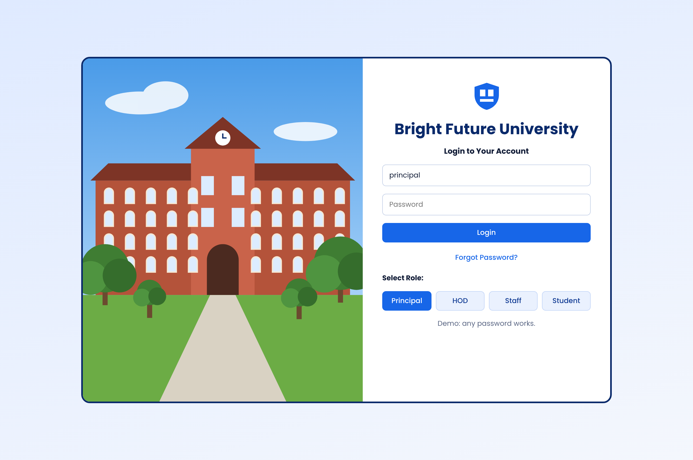
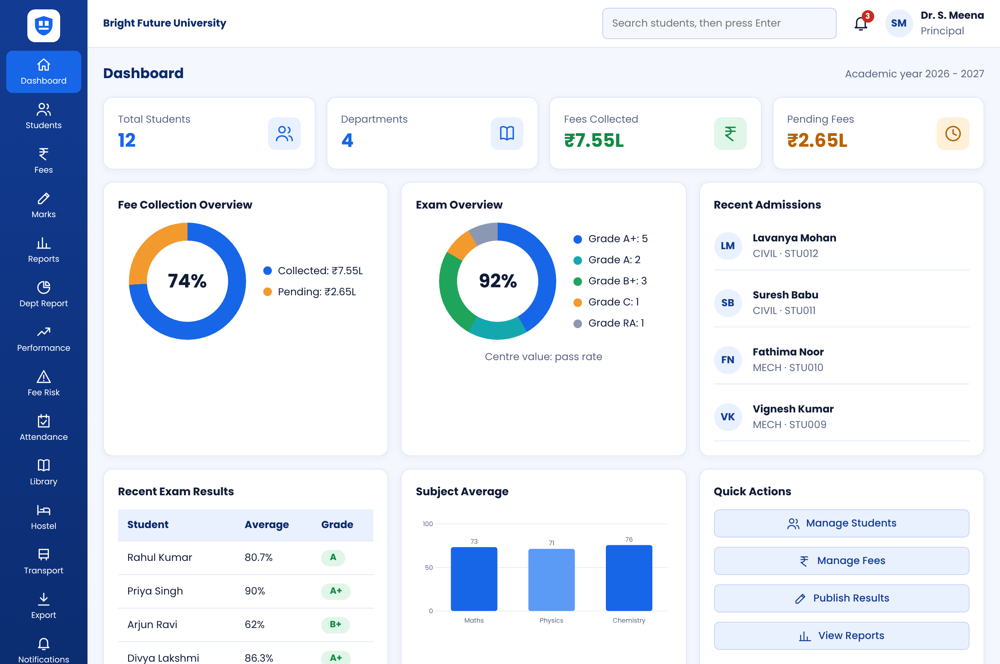
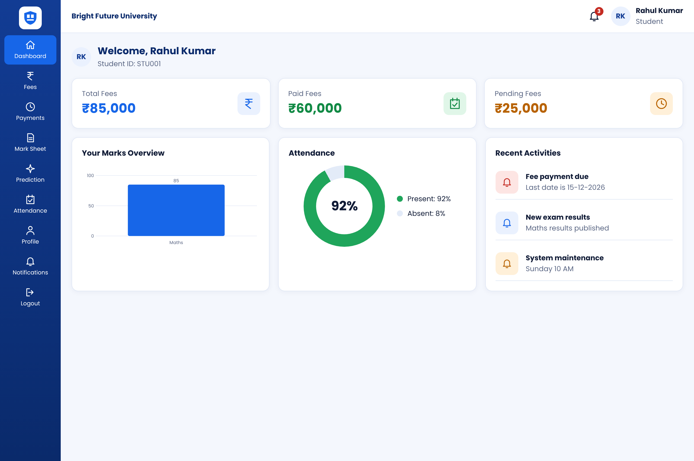
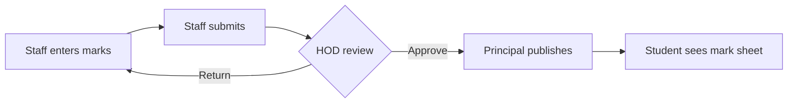

# College Fees and Marks Management System

A demo website for managing college fees and student marks, with separate logins for the **Principal, HOD, Staff and Student**. The college name, people and figures are sample data.



## Open the website

**On GitHub Pages**

1. Open this repository's **Settings → Pages**.
2. Under **Build and deployment**, set **Source** to *Deploy from a branch*.
3. Choose branch **main**, folder **/ (root)**, and press **Save**.
4. After a minute or two, open `https://<your-username>.github.io/<repository-name>/`.

**On your computer**

Download the repository (**Code → Download ZIP**), extract it, and double-click `index.html`. No installation or build step is needed.

## Demo logins

Select a role on the login page. The username fills in automatically.

| Role | Name | Username | Password |
| --- | --- | --- | --- |
| Principal | Dr. S. Meena | `principal` | Any password |
| HOD (CSE) | Dr. R. Karthik | `hod.cse` | Any password |
| Staff (CSE) | Ms. Priya Sharma | `staff.priya` | Any password |
| Student | Rahul Kumar | `STU001` | Any password |

> The site does not check usernames or passwords. The selected role decides which portal opens.

## Features

| Feature | Principal | HOD | Staff | Student |
| --- | :---: | :---: | :---: | :---: |
| Dashboard | ✔ | ✔ | ✔ | ✔ |
| Student list and profiles | ✔ | ✔ | ✔ | Own profile |
| Add, delete and bulk actions | ✔ | | | |
| Fees and reminders | ✔ | View and remind | | View and pay |
| Record payments | ✔ | | | Own (demo) |
| Enter and update marks | | | ✔ | |
| Approve or return marks | | ✔ | | |
| Publish results | ✔ | | | |
| Mark sheet | From profile | From profile | From profile | ✔ |
| Attendance | View | View | Update | View |
| Performance analysis | ✔ | ✔ | ✔ | Prediction |
| Fee risk analysis | ✔ | ✔ | | |
| Reports and department report | ✔ | ✔ | | |
| Export (CSV and PDF) | ✔ | ✔ | | Receipt and mark sheet |
| Library, hostel, transport | ✔ | | | |
| Settings and backup | ✔ | | | |
| Notifications | ✔ | ✔ | ✔ | ✔ |

## Screenshots

### Principal dashboard


### Student dashboard


## Marks approval flow



Try it: as **Staff**, open Marks and submit Chemistry. As **HOD**, approve it. As **Principal**, publish it. As **Student**, open Mark Sheet. Physics starts out waiting for HOD approval, so approve and publish it too for a complete mark sheet.

## Rules used

| Item | Rule |
| --- | --- |
| Marks | Internal out of 20, external out of 80 |
| Pass | Total at least 50 (changeable in Settings) and external at least 28 |
| Grades | O 91+, A+ 81+, A 71+, B+ 61+, B 56+, C below 56, RA for a fail |
| Fee per student | ₹85,000 |
| Attendance | 75% minimum |
| Fee risk score | Pending share × 60, plus 12 per late payment, capped at 95. High 50+, Medium 30+ |
| Performance prediction | 80% published marks plus 20% attendance |

Fee risk and prediction are simple formulas, not machine learning.

## Technology

- One file, `index.html`, written in plain HTML, CSS and JavaScript
- Charts drawn with SVG and CSS
- PDF and CSV files generated in the browser
- Data saved in the browser's `localStorage`
- Font: Poppins from Google Fonts, with a system font fallback

## Project structure

```
.
├── index.html       The whole website
├── screenshots/     Images used in this README
├── .nojekyll        Tells GitHub Pages to serve files as they are
└── README.md
```

## Changing the sample data

Open `index.html` and edit the `seed()` function for students, marks, payments, books, rooms and routes. The college name can also be changed in the website under **Settings → General Settings**.

After editing the data, use **Settings → Backup Database → Reset to sample data** to load it. This erases changes saved in that browser.

## Limitations

This is a front-end demo. **Do not enter real student or payment data.**

- No real authentication or access control
- No server or database: data stays in one browser
- No real payments
- Attendance history and performance trend values are generated samples

## Possible next steps

- A backend API and database
- Secure login with hashed passwords and role checks on the server
- A payment gateway
- Email or SMS reminders
